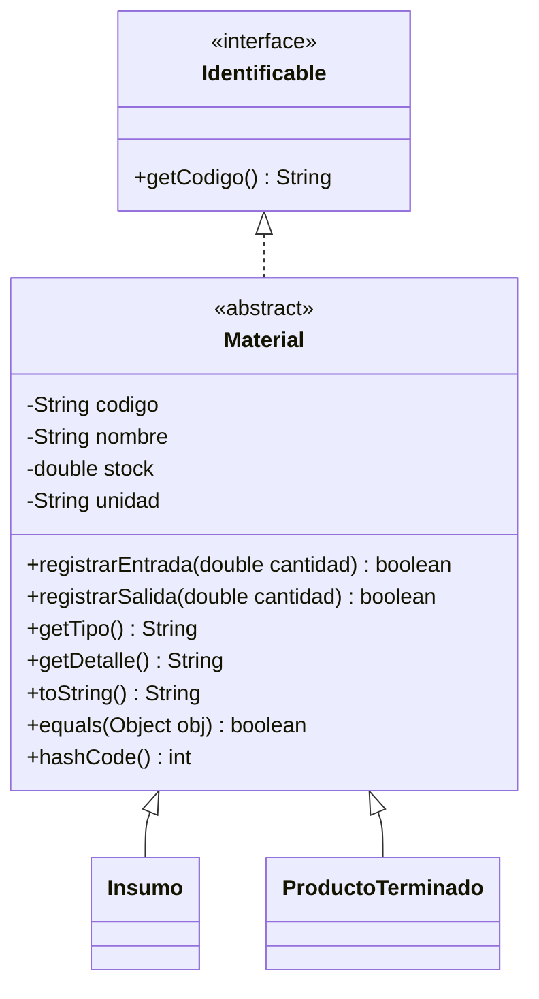
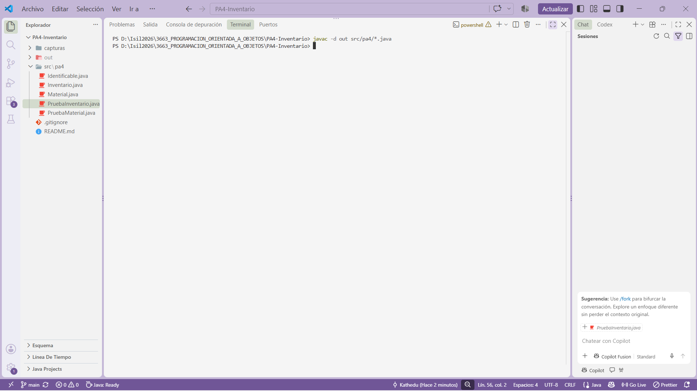
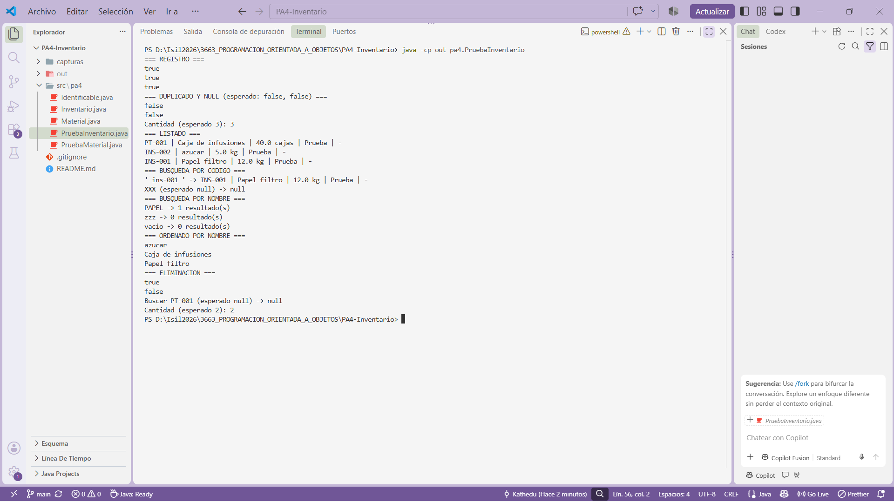

# PA4 - Sistema de Inventario de Almacén

Sistema Java de consola para registrar insumos y productos terminados, controlar stock, buscar y ordenar materiales. 


## Diseño
Material implementa Identificable y define atributos comunes y operaciones de stock. Las clases derivadas implementarán getTipo y getDetalle. La igualdad por código inmutable permitirá evitar duplicados en HashSet. El código se normaliza a mayúsculas y se eliminan espacios exteriores. El stock es double para admitir cantidades fraccionarias. Las operaciones de stock devuelven boolean; false indica rechazo sin modificar el stock.

### Diagrama de clases




## Compilación de la base
```bash
javac -d out src/pa4/*.java
```
## Ejecución después de integrar Main
```bash
java -cp out pa4.Main
```
## Evidencias
Las capturas de pantalla del funcionamiento y del código se guardarán en la carpeta `capturas`.

## Integrantes
- Integrante 1: Flor de Venus Torres Condori ( Identificable y Material)
- Integrante 2: Donny Scrach Gaspar Araujo (Insumo y ProductoTerminado)
- Integrante 3: Kathleen Carola Durand Quispe (Inventario)
- Integrante 4: Fabriccio Marticorena Colan (Main e integración)


## Aporte individual - Integrante 1: Venus

**Responsable:** Torres Condori Flor de Venus.

**Responsabilidad:** Estructura inicial, interfaz y clase abstracta del Sistema de Inventario de Almacén.

### Actividades desarrolladas

- Creación de la estructura inicial del proyecto Java.
- Creación y configuración del repositorio GitHub.
- Implementación de la interfaz Identificable.
- Implementación de la clase abstracta Material.
- Aplicación de abstracción y encapsulamiento.
- Implementación del constructor y métodos getters.
- Validación de entradas y salidas de stock.
- Declaración de los métodos abstractos getTipo() y getDetalle().
- Sobrescritura de toString(), equals() y hashCode().
- Prevención de materiales duplicados mediante su código.
- Desarrollo y ejecución de pruebas funcionales.

### Archivos desarrollados

| Archivo | Descripción |
|---|---|
| Identificable.java | Interfaz para identificar materiales mediante su código. |
| Material.java | Clase abstracta con atributos y comportamientos comunes. |
| PruebaMaterial.java | Clase auxiliar para realizar pruebas funcionales. |

### Compilación y ejecución de las pruebas

```bash
javac -d out src/pa4/*.java
java -cp out pa4.PruebaMaterial
```

### Resultados de las pruebas funcionales

| Prueba | Resultado | Estado |
|---|---|---|
| Stock inicial | 12 kg | Correcto |
| Entrada de 5 kg | 17 kg | Correcto |
| Salida de 3 kg | 14 kg | Correcto |
| Salida de 20 kg | Rechazada | Correcto |
| Entrada negativa | Rechazada | Correcto |
| Código duplicado | Rechazado | Correcto |
| Stock final | 14 kg | Correcto |

### Conclusión 

Las pruebas funcionales permitieron comprobar el correcto control de existencias y la prevención de códigos duplicados. Esta implementación facilita la integración de las clases derivadas y las colecciones desarrolladas por los demás integrantes del equipo.

### Aporte individual - Integrante 2: Donny Scrach Gaspar Araujo

**Responsable:** Donny Scrach Gaspar Araujo.

**Responsabilidad:** Implementación de las clases derivadas Insumo y ProductoTerminado del Sistema de Inventario de Almacén.

### Actividades desarrolladas

- Implementación de la clase `Insumo`, heredada de la clase abstracta `Material`.
- Implementación de la clase `ProductoTerminado`, heredada de la clase abstracta `Material`.
- Aplicación de herencia mediante la palabra reservada `extends`.
- Reutilización del constructor de la clase padre mediante `super()`.
- Implementación del atributo privado `proveedor` en la clase Insumo.
- Implementación del atributo privado `areaProduccion` en la clase ProductoTerminado.
- Aplicación de encapsulamiento mediante atributos privados y métodos getters.
- Validación de los datos específicos de cada clase para evitar valores nulos o vacíos.
- Sobrescritura de los métodos abstractos `getTipo()` y `getDetalle()` mediante `@Override`.
- Desarrollo de una clase auxiliar denominada `PruebaDonny` para verificar el funcionamiento de ambas clases.
- Ejecución de pruebas de creación de objetos y visualización de sus atributos heredados y específicos.

### Archivos desarrollados

| Archivo | Descripción |
|---|---|
| Insumo.java | Clase derivada de Material que representa los insumos e incorpora el atributo proveedor. |
| ProductoTerminado.java | Clase derivada de Material que representa los productos terminados e incorpora el área de producción. |
| PruebaDonny.java | Clase auxiliar para comprobar la creación y funcionamiento de objetos de ambas clases. |

### Métodos implementados

| Clase | Método | Descripción |
|---|---|---|
| Insumo | getProveedor() | Devuelve el proveedor del insumo. |
| Insumo | getTipo() | Devuelve la identificación del tipo de material. |
| Insumo | getDetalle() | Devuelve la información del proveedor. |
| ProductoTerminado | getAreaProduccion() | Devuelve el área de producción. |
| ProductoTerminado | getTipo() | Devuelve la identificación del producto terminado. |
| ProductoTerminado | getDetalle() | Devuelve la información del área de producción. |

### Compilación y ejecución de las pruebas

```bash
javac -d out src/pa4/*.java
java -cp out pa4.PruebaDonny
```

### Resultados de las pruebas funcionales

| Prueba | Resultado | Estado |
|---|---|---|
| Creación de objeto Insumo | Aceptada | Correcto |
| Creación de objeto ProductoTerminado | Aceptada | Correcto |
| Inicialización de atributos heredados | Correcta | Correcto |
| Obtención del proveedor | Proveedor Nacional | Correcto |
| Obtención del área de producción | Producción | Correcto |
| Sobrescritura de getTipo() | Ambos tipos identificados | Correcto |
| Sobrescritura de getDetalle() | Detalles mostrados correctamente | Correcto |
| Compilación y ejecución | Sin errores | Correcto |

### Evidencias

- Código fuente de Insumo.java.
- Código fuente de ProductoTerminado.java.
- Compilación y ejecución de PruebaDonny.java.
- Archivos publicados en el repositorio GitHub.

### Conclusión

La implementación permitió comprobar el funcionamiento de las clases derivadas Insumo y ProductoTerminado mediante herencia, reutilización de constructores, encapsulamiento y sobrescritura de métodos. Las pruebas realizadas verificaron la creación de objetos y la recuperación de sus atributos específicos, permitiendo su integración con la clase abstracta Material y el sistema de inventario desarrollado por el equipo.


## Aporte individual - Integrante 3: Kathleen Carola Durand Quispe 

**Responsable:** Durand Quispe Kathleen Carola.

**Responsabilidad:** Colección de objetos, búsqueda y ordenamiento del Sistema de Inventario de Almacén.

### Actividades desarrolladas

- Implementación de la clase Inventario con una colección genérica `Set<Material>` basada en `HashSet`.
- Registro de materiales con add(), impidiendo códigos repetidos mediante equals() y hashCode() de Material.
- Recorrido de la colección para listar los materiales y obtener la cantidad con size().
- Búsqueda lineal por código y búsqueda por coincidencia parcial en el nombre.
- Ordenamiento alfabético por nombre con ArrayList y Comparator.
- Eliminación de materiales por código con remove().
- Aplicación de polimorfismo: la colección usa Material y admite Insumo y ProductoTerminado.
- Aplicación de encapsulamiento: el conjunto es privado y listar() devuelve una copia.
- Desarrollo y ejecución de pruebas funcionales.

### Archivos desarrollados

| Archivo | Descripción |
|---|---|
| Inventario.java | Clase que administra la colección de materiales y sus operaciones. |
| PruebaInventario.java | Clase auxiliar para realizar pruebas funcionales de Inventario. |

### Métodos implementados

| Método | Descripción |
|---|---|
| registrar(Material) | Agrega un material; devuelve false si el código ya existe o si el objeto es null. |
| listar() | Recorre la colección y devuelve una copia en una lista. |
| buscarPorCodigo(String) | Búsqueda por código; devuelve null si no existe. |
| buscarPorNombre(String) | Búsqueda por coincidencia parcial, sin distinguir mayúsculas. |
| ordenarPorNombre() | Copia los materiales a un ArrayList y los ordena con Comparator. |
| eliminarPorCodigo(String) | Elimina un material; devuelve false si no existe. |
| cantidadMateriales() | Devuelve la cantidad de materiales registrados. |

### Compilación y ejecución de las pruebas

```bash
javac -d out src/pa4/*.java
java -cp out pa4.PruebaInventario
```

### Resultados de las pruebas funcionales

| Prueba | Resultado | Estado |
|---|---|---|
| Registro de 3 materiales con códigos distintos | Aceptados | Correcto |
| Código repetido (ins-001) | Rechazado | Correcto |
| Registro de null | Rechazado | Correcto |
| Cantidad de materiales | 3 | Correcto |
| Búsqueda por código " ins-001 " | Encuentra Papel filtro | Correcto |
| Búsqueda por código inexistente | null | Correcto |
| Búsqueda por nombre PAPEL | 1 resultado | Correcto |
| Búsqueda por nombre zzz y texto vacío | 0 resultados | Correcto |
| Ordenamiento por nombre | azucar, Caja de infusiones, Papel filtro | Correcto |
| Eliminación de PT-001 y repetición | true, luego false | Correcto |
| Cantidad final | 2 | Correcto |

### Evidencias





### Conclusión

Las pruebas funcionales comprobaron que Inventario registra materiales, rechaza códigos duplicados mediante HashSet, busca por código y por nombre, ordena alfabéticamente y elimina registros correctamente. Las pruebas se realizaron con una clase temporal derivada de Material y se repetirán con Insumo y ProductoTerminado al integrar el proyecto.

## Aporte individual - Integrante 4: Fabriccio Marticorena Colan


## Repositorio
https://github.com/FVenusTC/PA4-Inventario.git

## Video de YouTube

