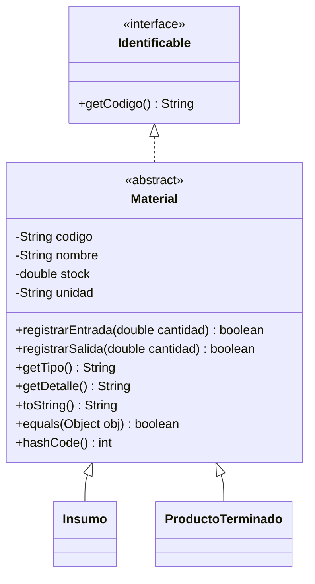

# PA4 - Sistema de Inventario de Almacén

Sistema Java de consola para registrar insumos y productos terminados, controlar stock, buscar y ordenar materiales. 


## Diseño
Material implementa Identificable y define atributos comunes y operaciones de stock. Las clases derivadas implementarán getTipo y getDetalle. La igualdad por código inmutable permitirá evitar duplicados en HashSet. El código se normaliza a mayúsculas y se eliminan espacios exteriores. El stock es double para admitir cantidades fraccionarias. Las operaciones de stock devuelven boolean; false indica rechazo sin modificar el stock.

### Diagrama de clases




## Compilación de la base
```bash
javac -d out src/pa4/*.java
```
## Ejecución después de integrar Main
```bash
java -cp out pa4.Main
```
## Evidencias
Las capturas de pantalla del funcionamiento y del código se guardarán en la carpeta `capturas`.

## Integrantes
- Integrante 1: Flor de Venus Torres Condori ( Identificable y Material)
- Integrante 2: Donny Scrach Gaspar Araujo (Insumo y ProductoTerminado)
- Integrante 3: Kathleen Carola Durand Quispe (Inventario)
- Integrante 4: Fabriccio Marticorena Colan (Main e integración)


## Aporte individual - Integrante 1: Venus

**Responsable:** Torres Condori Flor de Venus.

**Responsabilidad:** Estructura inicial, interfaz y clase abstracta del Sistema de Inventario de Almacén.

### Actividades desarrolladas

- Creación de la estructura inicial del proyecto Java.
- Creación y configuración del repositorio GitHub.
- Implementación de la interfaz Identificable.
- Implementación de la clase abstracta Material.
- Aplicación de abstracción y encapsulamiento.
- Implementación del constructor y métodos getters.
- Validación de entradas y salidas de stock.
- Declaración de los métodos abstractos getTipo() y getDetalle().
- Sobrescritura de toString(), equals() y hashCode().
- Prevención de materiales duplicados mediante su código.
- Desarrollo y ejecución de pruebas funcionales.

### Archivos desarrollados

| Archivo | Descripción |
|---|---|
| Identificable.java | Interfaz para identificar materiales mediante su código. |
| Material.java | Clase abstracta con atributos y comportamientos comunes. |
| PruebaMaterial.java | Clase auxiliar para realizar pruebas funcionales. |

### Compilación y ejecución de las pruebas

```bash
javac -d out src/pa4/*.java
java -cp out pa4.PruebaMaterial
```

### Resultados de las pruebas funcionales

| Prueba | Resultado | Estado |
|---|---|---|
| Stock inicial | 12 kg | Correcto |
| Entrada de 5 kg | 17 kg | Correcto |
| Salida de 3 kg | 14 kg | Correcto |
| Salida de 20 kg | Rechazada | Correcto |
| Entrada negativa | Rechazada | Correcto |
| Código duplicado | Rechazado | Correcto |
| Stock final | 14 kg | Correcto |

### Evidencias de mi participación

### Conclusión 

Las pruebas funcionales permitieron comprobar el correcto control de existencias y la prevención de códigos duplicados. Esta implementación facilita la integración de las clases derivadas y las colecciones desarrolladas por los demás integrantes del equipo.

## Aporte individual - Integrante 2:Donny Scrach Gaspar Araujo 
## Aporte individual - Integrante 3: Kathleen Carola Durand Quispe 
## Aporte individual - Integrante 4: Fabriccio Marticorena Colan


## Repositorio
https://github.com/FVenusTC/PA4-Inventario.git

## Video de YouTube

